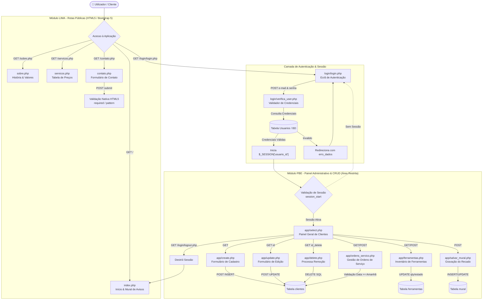
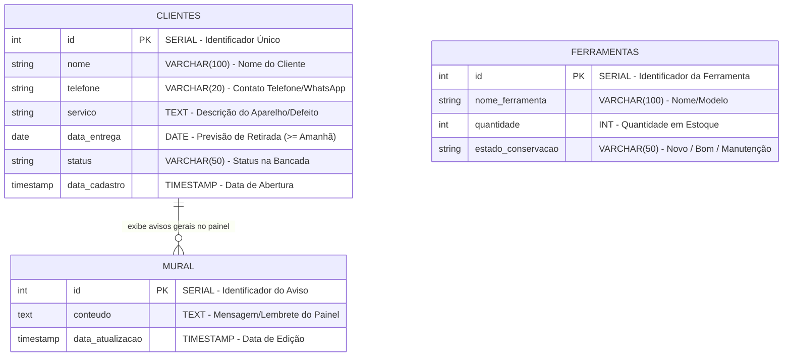
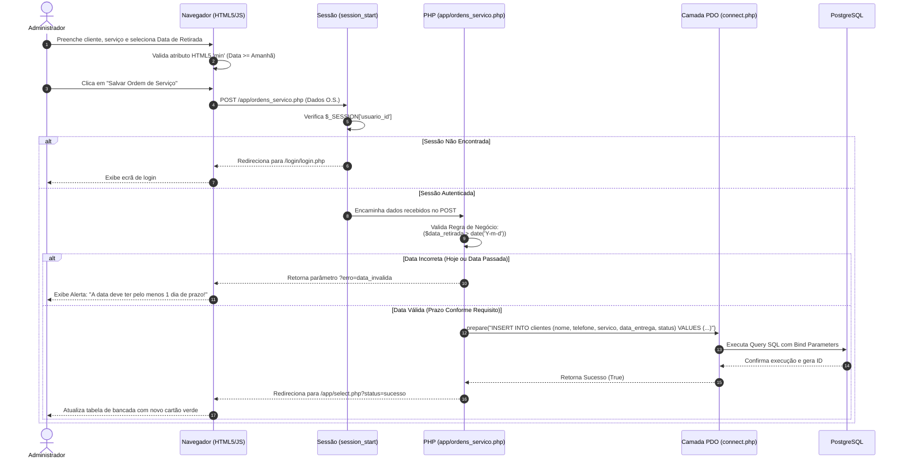

# 🛠️ AssistênciaCi — Sistema de Gestão de Bancada e Website Institucional

> **Projeto Integrador Final de Curso**  
> **Unidades Curriculares Integradas:**  
> - **LIMA** — Linguagem de Marcação (HTML5 Semântico, CSS3 e Bootstrap 5.3)  
> - **PBE** — Programação Back-End (PHP Estruturado, Programação Modular, Sessões e CRUD)  
> - **BCD** — Banco de Dados Relacional (PostgreSQL, Modelagem ER, Normalização e Conectividade PDO)

---


## 1.0 Guia Operacional Passo a Passo (Manual Completo do Proprietário)

### 1.1 Requisitos Mínimos do Sistema
1. **Servidor Web / Interpretador:** PHP na versão `8.0` ou superior.
2. **Sistema Gerenciador de Banco de Dados:** PostgreSQL `12.0` ou superior.
3. **Extensão PHP Ativa:** `pdo_pgsql` liberada no arquivo `php.ini`.
4. **Navegador Web Suportado:** Google Chrome, Mozilla Firefox, Microsoft Edge ou Safari atualizados.

### 1.2 Instalação e Configuração do Banco PostgreSQL
1. Abra o gerenciador do PostgreSQL (pgAdmin ou terminal psql).
2. Crie um novo banco de dados chamado `projeto_integrador`:
   ```sql
   CREATE DATABASE projeto_integrador;
   ```
3. Execute o script de criação das tabelas e carga inicial de dados:
   ```sql
   -- Tabela de Usuários
   CREATE TABLE usuarios (
       id SERIAL PRIMARY KEY,
       nome VARCHAR(100) NOT NULL,
       email VARCHAR(100) UNIQUE NOT NULL,
       senha VARCHAR(255) NOT NULL
   );

   -- Inserção do Administrador Padrão
   INSERT INTO usuarios (nome, email, senha) 
   VALUES ('Administrador', 'adm@adm.com', 'adm123');

   -- Tabela de Clientes e Ordens de Serviço
   CREATE TABLE clientes (
       id SERIAL PRIMARY KEY,
       nome VARCHAR(100) NOT NULL,
       telefone VARCHAR(20) NOT NULL,
       servico TEXT NOT NULL,
       data_entrega DATE NOT NULL,
       status VARCHAR(50) DEFAULT 'Em Análise',
       data_cadastro TIMESTAMP DEFAULT CURRENT_TIMESTAMP
   );

   -- Tabela do Inventário de Ferramentas
   CREATE TABLE ferramentas (
       id SERIAL PRIMARY KEY,
       nome_ferramenta VARCHAR(100) NOT NULL,
       quantidade INT NOT NULL DEFAULT 1,
       estado_conservacao VARCHAR(50) NOT NULL
   );

   -- Tabela do Mural de Avisos
   CREATE TABLE mural (
       id SERIAL PRIMARY KEY,
       conteudo TEXT NOT NULL,
       data_atualizacao TIMESTAMP DEFAULT CURRENT_TIMESTAMP
   );
   ```

### 1.3 Clonagem do Repositório e Configuração Local
1. Abra o terminal ou prompt de comando na pasta desejada.
2. Execute o comando de clonagem:
   ```bash
   git clone [https://github.com/Gregorio14izi/Assist-nciaCI-.git](https://github.com/Gregorio14izi/Assist-nciaCI-.git) projeto_integrador
   cd projeto_integrador
   ```
3. Abra o arquivo `database/connect.php` e ajuste os dados da sua conexão local com o PostgreSQL:
   ```php
   $host   = '127.0.0.1';
   $port   = '5432';
   $dbname = 'projeto_integrador';
   $user   = 'postgres'; // Seu usuário do PostgreSQL
   $pass   = 'sua_senha'; // Sua senha do PostgreSQL
   ```

### 1.4 Execução via Servidor PHP Embutido
#### Dentro da pasta `projeto_integrador`, inicie o servidor embutido na porta `8000`:
   ```bash
   php -S localhost:8000
   ```
---
Depois de criado o banco com as tabelas o site funciona perfeitamente (na teoria).
Este guia prático foi elaborado para orientar o proprietário da assistência ou os técnicos de bancada na operação diária do site.

### 1.5 Início de Expediente e Autenticação no Sistema
1. Abra o navegador web (Google Chrome, Firefox, Edge ou Safari).
2. Digite o endereço do sistema (ex.: `http://localhost:8000/index.php` ou o domínio do seu servidor).
3. No menu superior da página, clique no botão amarelo **Área Restrita / Login**.
4. Para cadastrar o email de administrador, escreva "setup.php" logo após de "projeto_integrador" (http://192.168.10.24/projeto_integrador/* a onde está o asterisco)
5. Insira o e-mail cadastrado (`adm@adm.com`) e a senha (`adm123`).
6. Clique em **Entrar**. O sistema redirecionará para a tela principal do painel administrativo (`app/select.php`).

### 1.6 Fluxo Completo de Entrada de Equipamento (Nova O.S.)
1. No painel administrativo, clique no botão **Novo Cadastro / Registrar O.S.** (`app/create.php`).
2. **Preenchimento de Dados do Cliente:**
   - **Nome do Cliente:** Digite o nome completo do proprietário.
   - **Telefone / WhatsApp:** Digite o número com DDD para envio de avisos de conclusão.
3. **Preenchimento de Dados do Equipamento:**
   - **Equipamento & Defeito:** Especifique a marca, modelo e o problema relatado (ex.: *"Samsung Galaxy S21 - Tela quebrada e sem dar imagem"*).
4. **Definição da Data de Retirada:**
   - **Seletor de Data:** Escolha a data prevista para entrega. O sistema **bloqueará automaticamente** a escolha do dia de hoje ou dias anteriores, garantindo o prazo técnico mínimo de 24 horas.
5. Clique em **Salvar Registro**. A nova Ordem de Serviço será criada com o status inicial `Em Análise`.

### 1.7 Fluxo de Acompanhamento e Atualização de Status da Bancada
1. Acesse o painel geral (`app/select.php`).
2. Localize a O.S. pelo nome do cliente ou pelo número do ID.
3. Clique no botão **Editar / Atualizar** (`app/update.php`).
4. Conforme o trabalho progrida na bancada, altere o campo **Status do Serviço**:
   - **Em Análise:** O aparelho está sob diagnóstico técnico.
   - **Aguardando Peça:** O orçamento foi aprovado e a peça de reposição foi encomendada.
   - **Em Manutenção:** O reparo ou soldagem está em execução na bancada.
   - **Pronto para Retirada:** O serviço foi concluído e testado. O cliente já pode vir buscar.
   - **Entregue:** O equipamento foi devolvido e o valor foi quitado.
5. Clique em **Salvar Alterações** para registrar o novo estado no banco de dados.

### 1.8 Fluxo de Entrega do Aparelho e Finalização da O.S.
1. Quando o cliente chegar à loja para retirar o aparelho, localize a O.S. no painel.
2. Altere o status para `Entregue`.
3. Caso necessite remover o registro do histórico ativo, clique em **Excluir** e confirme a operação na caixa de diálogo de segurança.

### 1.9 Operação do Estoque de Ferramentas da Oficina
1. No menu superior do painel administrativo, clique na aba **Ferramentas** (`app/ferramentas.php`).
2. **Para adicionar um novo item:** Preencha o nome da ferramenta (ex.: *"Manta Térmica Anti-Estática"*), a quantidade inicial e escolha o estado de conservação.
3. **Para ajustar a quantidade:** Utilize os botões rápidos de soma (`+`) ou subtração (`-`) para registrar novos itens comprados ou quebrados.
4. **Para registrar manutenção de equipamentos:** Altere o estado de conservação para `Necessita Manutenção` para evitar que outro técnico utilize uma ferramenta defeituosa.

### 1.10 Publicação de Lembretes no Mural de Bancada
1. No painel principal, navegue até a área do **Mural de Avisos**.
2. Digite o comunicado desejado (ex.: *"Atenção equipe: Chegada de novo lote de baterias no período da tarde"*).
3. Clique em **Salvar Recado**. O aviso ficará visível no painel administrativo e na página inicial do site para toda a equipe.

### 1.11 Encerramento Seguro de Sessão (Logout)
1. Ao sair do computador da recepção ou da bancada, clique no botão vermelho **Sair** no canto superior direito.
2. A sessão de usuário será encerrada imediatamente, protegendo os dados dos clientes contra acessos não autorizados.

---
## 2.0 Visão Geral, Origem e Objetivos Estratégicos

### 2.1 Apresentação Institucional da AssistênciaCi
1. A **AssistênciaCi** é uma plataforma web para gestão simplificada de assistências técnicas especializadas em manutenção de eletrônicos (smartphones, tablets, notebooks e computadores de mesa).
2. O sistema integra, numa única solução, um catalogo de clientes, projetos e ferramentas e um ambiente administrativo privado para acompanhamento do fluxo de reparações na bancada.

### 2.2 História de Origem da Empresa (A Amizade na Bancada)
1. A fundação da **AssistênciaCi** nasceu de um ambiente informal e amigável: encontros casuais entre amigos fascinados por resenha no tempo livre, aonde deu a ideia ao projeto.
2. Para homenagear e eternizar essa ligação de companheirismo, eu decidi formalizar a brincadeira como a história oficial da empresa.
4. Essa essência reflete-se na filosofia de trabalho da loja: tratamento humano, transparência absoluta nos orçamentos e compromisso de amigo na entrega de cada equipamento.

### 2.3 Objetivos Estratégicos da Plataforma
1. **Controle Operacional de Bancada:** Permitir a abertura, alteração de status e controle de prazos de entrega de Ordens de Serviço (O.S.).
2. **Gestão de Ferramental e Ativos:** Monitorar a quantidade e o estado de conservação das ferramentas essenciais da oficina.
3. **Comunicação Interna Agilizada:** Fornecer um mural virtual de avisos e lembretes para recados urgentes entre técnicos.

---

## 3.0 Arquitetura Técnica e Detalhamento de Módulos

### 3.1 Módulo LIMA — Website Institucional Público (HTML5 / CSS3 / Bootstrap 5)

#### 3.1.1 Página Inicial (`index.php`)
- **Navegação Principal (`<nav>`):** Menu responsivo com marcação Bootstrap e links dinâmicos resolvidos via `$baseUrl`.
- **Painel Hero (`<section>`):** Apresentação do slogan da loja, chamada para ação (CTA) e destaques visuais.
- **Quadro de Avisos Públicos (`<aside>`):** Área dinâmica que exibe comunicados e horários especiais cadastrados no mural.

#### 3.1.2 Página Sobre A Empresa (`sobre.php`)
- **Narrativa da Origem (`<article>`):** Detalhamento da trajetória amigável dos fundadores e a transformação em empresa.
- **Ilustração Institucional (``):** Renderização vetorial responsiva da bancada técnica (`assets/img/oficina.svg`).
- **Blocos de Identidade Organizacional (`<section>`):**
  - **Missão:** Prestar serviços de manutenção com empatia, verdade e precisão técnica.
  - **Visão:** Tornar-se a assistência técnica mais confiável da região mantendo o acolhimento humano.
  - **Valores:** Amizade, honestidade de orçamento, pontualidade e inovação contínua.

#### 3.1.3 Catálogo de Serviços e Preços (`servicos.php`)
- **Cards de Categorias (`<article>`):** Exibição de serviços para Smartphones (`reparo-celular.svg`) e Notebooks (`reparo-notebook.svg`).
- **Tabela Transparente de Preços (`<table>`):**
  - **Cabeçalho (`<thead>`):** Descrição do Serviço, Prazo Médio, Garantia Legal e Valor Estimado.
  - **Acessibilidade:** Uso rigoroso de `scope="col"`, contraste adequado e formatação monetária em Reais (`R$`).

#### 3.1.4 Página de Contato e Localização (`contato.php`)
- **Formulário de Atendimento (`<form>`):**
  - **Campos:** Nome Completo (`required`), E-mail (`type="email"`), Telefone (`type="tel"`) e Descrição do Problema.
  - **Validação Nativa:** Atributos HTML5 `placeholder`, `label` associados por `for` e alertas nativos.
- **Painel Informativo (`<aside>`):** Endereço físico, mapa conceitual, e-mail de suporte e horários de funcionamento.

---

### 3.2 Módulo PBE — Back-end, Lógica de Negócio e CRUD em PHP

#### 3.2.1 Autenticação e Controle de Acesso (`login/`)
1. **Validação de Credenciais (`login/verifica_user.php`):** Consulta sanitizada no PostgreSQL para verificar e-mail e palavra-passe.
2. **Sessões do PHP (`session_start()`):** Criação de token de sessão `$_SESSION['usuario_id']` e `$_SESSION['usuario_nome']`.
3. **Proteção de Rotas:** Todos os arquivos da pasta `app/` verificam a existência de sessão ativa; caso contrário, redirecionam imediatamente para a tela de login.
4. **Encerramento (`login/logout.php`):** Limpeza total das variáveis de sessão e destruição via `session_destroy()`.

#### 3.2.2 Gestão Centralizada de Clientes e Aparelhos (`app/`)
1. **Inclusão / Create (`app/create.php`):** Formulário de registro de novos clientes e equipamentos na bancada.
2. **Consulta / Read (`app/select.php` & `app/select_where.php`):** Listagem em tabela com suporte a filtros e visualização de detalhes.
3. **Edição / Update (`app/update.php`):** Alteração de dados cadastrais, telefone e mudança de status do serviço.
4. **Remoção / Delete (`app/delete.php`):** Exclusão de registros do banco com confirmação de segurança.

#### 3.2.3 Regra de Negócio Dinâmica de Prazos de Retirada
1. **Margem Mínima de Manutenção:** Nenhuma Ordem de Serviço pode ser agendada para entrega no próprio dia da abertura ou em datas passadas.
2. **Validação no Front-end:** Atributo HTML5 `min="<?= date('Y-m-d', strtotime('+1 day')); ?>"` aplicado no input de data.
3. **Validação no Back-end:** Verificação condicional em PHP antes da instrução SQL:
   ```php
   if (strtotime($data_entrega) <= strtotime(date('Y-m-d'))) {
       header("Location: create.php?erro=data_invalida");
       exit();
   }
   ```

#### 3.2.4 Módulo de Gestão do Inventário de Ferramentas (`app/ferramentas.php`)
1. **Controle de Quantidade:** Incremento e decremento rápido de itens de bancada (multímetros, estações de solda, chaves).
2. **Estado de Conservação:** Classificação de cada item entre `Excelente`, `Bom`, `Necessita Manutenção` ou `Substituir`.

#### 3.2.5 Módulo de Mural de Recados Internos (`app/salvar_mural.php`)
1. **Persistência de Mensagens:** Gravação e atualização do aviso principal exibido tanto no painel admin quanto na página inicial pública.

---

### 3.3 Módulo BCD — Banco de Dados Relacional PostgreSQL

#### 3.3.1 Dicionário de Dados e Estrutura das Tabelas

##### A. Tabela `usuarios` (Controle de Acesso)
- `id` (`SERIAL`, Chave Primária): Identificador único do utilizador.
- `nome` (`VARCHAR(100)`): Nome completo do operador.
- `email` (`VARCHAR(100)`, Único): E-mail utilizado para login.
- `senha` (`VARCHAR(255)`): Palavra-passe de acesso.

##### B. Tabela `clientes` (Ordens de Serviço e Clientes)
- `id` (`SERIAL`, Chave Primária): Número identificador da O.S. / Cliente.
- `nome` (`VARCHAR(100)`): Nome do cliente proprietário do aparelho.
- `telefone` (`VARCHAR(20)`): Telefone/WhatsApp para contato e avisos.
- `servico` (`TEXT`): Especificação do modelo do aparelho e defeito relatado.
- `data_entrega` (`DATE`): Previsão técnica de conclusão e retirada.
- `status` (`VARCHAR(50)`): Estado do processo (`Em Análise`, `Aguardando Peça`, `Em Manutenção`, `Pronto para Retirada`, `Entregue`).
- `data_cadastro` (`TIMESTAMP`): Data e hora exatas da entrada na bancada.

##### C. Tabela `ferramentas` (Ativos da Oficina)
- `id` (`SERIAL`, Chave Primária): Identificador da ferramenta.
- `nome_ferramenta` (`VARCHAR(100)`): Descrição da ferramenta ou equipamento.
- `quantidade` (`INT`): Número de unidades disponíveis na bancada.
- `estado_conservacao` (`VARCHAR(50)`): Condição operacional do item.

##### D. Tabela `mural` (Comunicação)
- `id` (`SERIAL`, Chave Primária): Identificador do aviso.
- `conteudo` (`TEXT`): Texto do recado ou comunicado oficial.
- `data_atualizacao` (`TIMESTAMP`): Data e hora da última modificação.

#### 3.3.2 Segurança e Abstração com PDO
1. **Driver PDO PostgreSQL:** Conexão estabelecida em `database/connect.php` via `new PDO("pgsql:host=$host;port=$port;dbname=$dbname", $user, $pass)`.
2. **Proteção Contra SQL Injection:** Todas as inserções, edições e consultas utilizam *Prepared Statements* com `prepare()`, `bindValue()` e `execute()`.

---

## 4.0 Diagramas Funcionais, Mermaid e Modelagem de Dados

### 4.1 Diagrama de Arquitetura Funcional e Fluxo de Navegação Detalhado



---

### 4.2 Diagrama Entidade-Relacionamento (Modelo BCD)



---

### 4.3 Diagrama Sequencial Dinâmico (Ciclo Completo de Abertura de O.S.)



---

## 5.0 Resolução Dinâmica de URLs (`$baseUrl`) e Infraestrutura

### 5.1 Mecanismo de Identificação Automática de Caminhos
Para garantir que a aplicação funcione em qualquer servidor web local ou remoto sem a necessidade de alterar links manualmente, o arquivo `includes/header.php` calcula a raiz do projeto em tempo de execução:

```php
// Cálculo dinâmico do caminho base do projeto
$protocol   = (isset($_SERVER['HTTPS']) && $_SERVER['HTTPS'] === 'on') ? "https" : "http";
$host       = $_SERVER['HTTP_HOST'];
$projectDir = str_replace('\\', '/', realpath(__DIR__ . '/..'));
$docRoot    = str_replace('\\', '/', realpath($_SERVER['DOCUMENT_ROOT']));
$basePath   = str_replace($docRoot, '', $projectDir);
$baseUrl    = $protocol . "://" . $host . rtrim($basePath, '/') . '/';
```

### 5.2 Vantagens do Algoritmo de Resolução Dinâmica
1. **Portabilidade Total:** O projeto pode ser renomeado (ex.: de `Assist-nciaCI-` para `projeto_integrador`) sem quebrar imagens ou estilos.
2. **Suporte a Subpastas:** Funciona perfeitamente em servidores locais (`localhost:8000/projeto_integrador/`) ou em servidores de hospedagem remota em produção.
3. **Eliminação de Erros 404:** Todas as tags `href` e `src` passam a utilizar a variável `<?= $baseUrl; ?>`, eliminando apontamentos absolutos incorretos.

---

## 6.0 Estrutura Hierárquica de Diretórios e Arquivos

```text
projeto_integrador/
├── app/                      # Módulos Administrativos e Gestão de Bancada (PBE)
│   ├── create.php            # Formulário de abertura de O.S. e cadastro de clientes
│   ├── delete.php            # Processamento de remoção de registros do banco
│   ├── ferramentas.php       # Gestão do inventário e estado das ferramentas de bancada
│   ├── ordens_servico.php    # Controle central e alteração de status de reparações
│   ├── salvar_mural.php      # Processamento e atualização dos recados do mural
│   ├── select.php            # Tabela geral de acompanhamento de O.S. e clientes
│   ├── select_where.php      # Filtro e consulta detalhada por ID do registro
│   └── update.php            # Edição de cadastros, telefones e status do serviço
├── assets/                   # Recursos Estáticos Visuais
│   ├── css/                  # Folhas de estilo personalizadas
│   │   └── style.css         # Estilização da paleta amarela/preta e ajustes de layout
│   └── img/                  # Imagens e vetores SVG da marca AssistênciaCi
│       ├── atendimento.svg   # Vetor da área de recepção e contato público
│       ├── logo.svg          # Logotipo vetorial oficial do sistema
│       ├── oficina.svg       # Ilustração da bancada técnica de reparos
│       ├── reparo-celular.svg# Ícone institucional de reparos em smartphones
│       └── reparo-notebook.svg# Ícone institucional de manutenção em notebooks
├── database/                 # Camada de Conectividade com Banco de Dados (BCD)
│   └── connect.php           # Configuração da conexão PDO com PostgreSQL
├── documentacao/             # Documentos e Mapeamento de Requisitos do Projeto
│   ├── complementos.md
│   ├── mapeamento.md
│   └── requisitos.md
├── includes/                 # Componentes Modulares Reutilizáveis
│   ├── footer.php            # Rodapé institucional em HTML5 semântico
│   ├── functions.php         # Funções auxiliares de sanitização e segurança
│   └── header.php            # Cabeçalho, navegação e cálculo dinâmico do $baseUrl
├── login/                    # Autenticação e Controle de Sessão de Usuários
│   ├── cadastrar.php         # Tela de registro de novos operadores
│   ├── login.php             # Tela de login e formulário de credenciais
│   ├── logout.php            # Encerramento seguro de sessão e redirecionamento
│   └── verifica_user.php     # Validação de e-mail e senha no banco de dados
├── contato.php               # Página institucional pública de atendimento
├── index.php                 # Página principal pública e quadro de avisos
├── README.md                 # Documentação técnica oficial e manual do sistema
├── servicos.php              # Catálogo de serviços e tabela transparente de preços
└── sobre.php                 # Página institucional da história e valores da loja
```

---

## 7.0 Matriz de Rastreabilidade e Critérios Avaliativos

| Nº | Critério Avaliativo | Módulo | Descrição Completa do Atendimento | Status |
| :-: | :--- | :---: | :--- | :-: |
| 1 | **Semântica HTML5** | **LIMA** | Uso obrigatório das tags `<header>`, `<nav>`, `<main>`, `<section>`, `<article>`, `<aside>` e `<footer>`. | **100% Atendido** |
| 2 | **Acessibilidade e Padrões** | **LIMA** | Atributo `lang="pt-BR"`, declaração de `charset="UTF-8"`, hierarquia correta de títulos (`<h1>`-`<h3>`) e texto `alt=""` descritivo em todas as imagens. | **100% Atendido** |
| 3 | **Formulários e Tabelas** | **LIMA** | Formulários com `label` explícitos, `placeholder` orientativos, validações `required` e Tabela Comparativa Transparente de Preços. | **100% Atendido** |
| 4 | **Operações CRUD Completas** | **PBE** | Implementação funcional de Cadastro (`CREATE`), Consulta (`READ`), Atualização (`UPDATE`) e Exclusão (`DELETE`) em PHP. | **100% Atendido** |
| 5 | **Regra de Negócio de Prazos** | **PBE** | Validação no servidor e no navegador impedindo a entrega no mesmo dia da abertura ou em datas passadas (prazo mínimo de 24h). | **100% Atendido** |
| 6 | **Controle de Sessão** | **PBE** | Proteção de arquivos administrativos verificando autenticação do operador e encerramento via `logout.php`. | **100% Atendido** |
| 7 | **Modelagem e Persistência** | **BCD** | Criação de esquema relacional no PostgreSQL com chaves primárias sequenciais e execução de consultas seguras via PDO. | **100% Atendido** |

---

## 8.0 Troubleshooting e Resolução de Problemas Frequentes

### 8.1 Erro de Conexão com o Banco de Dados (`PDOException`)
- **Sintoma:** O navegador exibe a mensagem *"Fatal Error: Could not connect to database"*.
- **Causa:** As credenciais no arquivo `database/connect.php` não correspondem ao seu PostgreSQL local ou o serviço do PostgreSQL está parado.
- **Solução:**
  1. Verifique se o serviço do PostgreSQL está rodando no Windows/Linux.
  2. Abra o arquivo `database/connect.php` e confirme o nome da porta (padrão `5432`), nome do banco (`projeto_integrador`), usuário e senha.

### 8.2 Erro 404 (Not Found) ao Executar o Servidor PHP
- **Sintoma:** Ao tentar acessar `http://localhost:8000/index.php`, o navegador exibe *"Not Found - The requested resource was not found on this server"*.
- **Causa:** O comando `php -S localhost:8000` foi executado numa pasta diferente da pasta onde estão guardados os arquivos do projeto.
- **Solução:**
  1. Abra a pasta do projeto no VS Code.
  2. Abra o terminal integrado e confirme que o caminho exibido termina em `...\projeto_integrador>`.
  3. Execute o comando `php -S localhost:8000` diretamente dentro dessa pasta.

### 8.3 Erro de Renderização de Diagramas no GitHub
- **Sintoma:** O GitHub exibe a mensagem *"Não foi possível renderizar a exibição rica"* no bloco de código Mermaid.
- **Causa:** Presença de caracteres especiais (como `/`, `(`, `)`, `&`) nos nomes dos `subgraph` sem o uso de aspas.
- **Solução:** Certifique-se de que todos os títulos de `subgraph` estão declarados com aspas duplas, por exemplo: `subgraph LIMA ["Módulo LIMA - Rotas Públicas (HTML5)"]`.

---

## 9.0 Considerações Finais 
### Gostaria de agradecer a paciência de todos e gostaria de agradecer todos aos que me ajudaram a concluir este projeto!

Estesistema foi projetado e desenvolvido por **Gregorio** como Projeto Integrador para conclusão e avaliação técnica nas unidades curriculares de **LIMA** (Linguagem de Marcação), **PBE** (Programação Back-End) e **BCD** (Banco de Dados Relacional).
